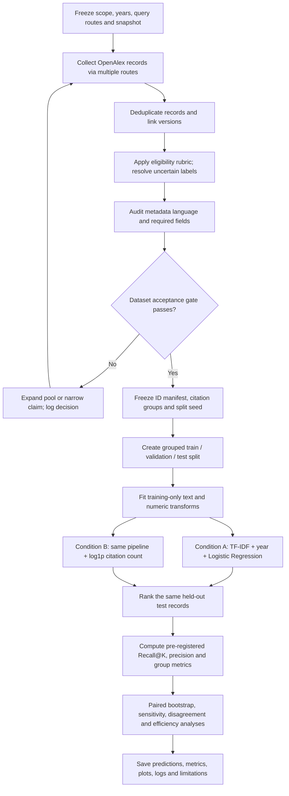

# Prompt 07 — Frozen Experiment Blueprint and Pre-Experiment Checklist

**Student:** Aditya Chaudhary  
**Enrollment:** MNS2026008  
**Course:** AI Tools for Research  
**Project working title:** *Effect of Citation-Count Features on Lower-Citation Recall in AI Literature Curation*  
**Protocol version:** 1.0  
**Protocol freeze date:** 30 October 2026  
**Status:** Protocol specified; **dataset acceptance gate remains OPEN**. No main model or test result has been run or inspected.

## 1. Purpose and boundary

This protocol freezes the minimum credible experiment for testing whether adding an explicit citation-count feature changes the ranking of relevant papers in a fixed candidate pool. It follows Prompt 05's research questions and Prompt 06's conditional dataset recommendation.

The target literature is research on computational methods for scholarly-literature discovery and curation: scholarly retrieval, citation searching, paper ranking/recommendation, title/abstract screening, study selection, and systematic-review/evidence-synthesis automation. Papers that merely apply AI to medicine, education, or another domain are out of scope unless the paper's method itself addresses literature curation.

**The protocol is frozen, but the experiment is not authorized to start until the dataset gate in Section 4 passes.** The existing 28-record OpenAlex pilot is not an eligible train, validation, or test dataset. Its six preliminary positive labels have not been independently adjudicated, and the pilot's group counts cannot support the proposed evaluation. This document makes no prediction about which ranker will perform better and reports no experimental result.

## 2. Research question, hypotheses and estimands

### Primary question (RQ1)

Does adding `log1p(cited_by_count)` change **pool-relative Recall@K for relevant lower-citation records** compared with an otherwise identical citation-blind ranker?

- **H1 (tentative):** the citation-blind ranker may retrieve more lower-citation relevant records near the top of the ranking.
- **Primary estimand:** paired difference

  `Δ_low = Recall@K_low(citation-blind) − Recall@K_low(citation-aware)`.

- Positive `Δ_low` favours the citation-blind condition for lower-citation recall. A value of zero means no measured difference; a negative value favours the citation-aware condition.
- Recall is relative to this documented candidate pool, not to every relevant publication in existence.

### Secondary questions

- **RQ2 — citation-group disparity:** compare the absolute high-/low-citation recall gap for the two conditions. `Gap = |Recall@K_high − Recall@K_low|`; a smaller gap means more similar group recall in this pool, not proof of general fairness.
- **RQ3 — language, conditional:** estimate the same paired feature effect for English versus non-English *metadata-language* groups only if language labels are audited and each group has enough relevant test records. Otherwise report counts and mark the comparison exploratory or not estimable. Do not make a confirmatory language-bias claim from sparse groups.

## 3. Dataset definition and construction protocol

### 3.1 Source and time window

- **Preferred source:** OpenAlex Works metadata, subject to the data gate below.
- **Publication window:** 1 January 2015 through 31 December 2025, inclusive.
- **Candidate-pool ceiling:** target no more than 3,000 unique records for the first full annotation pass. If this cap must be exceeded to satisfy the label/group gate, record the extension and its reason before any model is fitted or test scores are inspected.
- **Snapshot:** record the actual UTC collection timestamp, query parameters, OpenAlex work IDs, source-route tags, API version/endpoint if available, and citation-count snapshot date. Do not fill these with an estimated or invented timestamp.
- **Allowed sources/routes:** union results from multiple documented topic-query routes and a documented seed-paper citation-chasing route. Search routes must include the exact query strings in the data log. The planned topic phrases are: `automated literature screening`; `systematic review automation`; `scholarly information retrieval`; `citation-based scholarly search`; `scientific paper recommendation`; `AI-assisted evidence synthesis`; `active learning title abstract screening`; and `literature-based discovery`. These are candidate retrieval routes, not claims that the search is exhaustive.
- Do not build the pool only from OpenAlex's default top-ranked results: its relevance ranking may use citation-related information. Retain route provenance, union routes, deduplicate, and document any sampling/cap rule. Because the candidate pool is retrieved rather than a census, all recall values remain pool-relative.

### 3.2 Required fields and inclusion rules

Store one row per unique work with, at minimum: stable OpenAlex ID; DOI where available; title; publication year; `cited_by_count`; OpenAlex `language` value; reconstructed abstract availability indicator; retrieval route(s); record type; relevance label; label rationale; and duplicate-cluster ID. Keep reconstructed abstract plaintext in the private working area and out of shared/public deliverables unless redistribution is explicitly permitted.

Include records only when the title/abstract and source metadata permit an eligibility decision under the scope in Section 1. Exclude duplicates, retractions, non-research notices, records outside the date range, and records whose subject is outside scope. Do not exclude a paper just because it has few citations or is non-English. A missing abstract is allowed only if the title plus reliable record-level evidence supports a defensible label; otherwise mark `uncertain` and resolve it before the dataset freeze. Exclude records with no usable title from model evaluation and log the count/reason.

### 3.3 Deduplication and versions

Deduplicate before labelling and splitting, in this order: exact OpenAlex ID; normalized DOI; then normalized title plus year and author evidence for likely preprint/conference/journal versions. Keep a duplicate-cluster ID and the retained canonical record. Related versions must remain in one group and must never cross train/validation/test. Document ambiguous merges instead of silently deleting them.

### 3.4 Relevance labels

Use three working labels during screening: `relevant`, `not_relevant`, and `uncertain`. Only adjudicated relevant/not-relevant records enter the binary model dataset. Apply the same written scope to all languages and citation groups. For every decision, save a concise reason and label provenance. Review all uncertain records before freeze. If a second reviewer is available, have them independently review all uncertain records and a stratified random 20% of decided records; report agreement and adjudication. If a second reviewer is unavailable, say so explicitly and have the primary reviewer re-check uncertain cases plus a seeded random 20% after a time gap; describe this as a consistency audit, **not** independent inter-rater validation.

### 3.5 Metadata-language validation

OpenAlex's language field is inferred from metadata and must be called **metadata language** unless the actual publication language is checked. Independently inspect a seeded sample of at least 50 records or 10% of the pool (whichever is larger, capped at 200) against the publication itself or a reliable publisher/library record. Stratify the sample across available metadata-language groups. Record agreement, disagreement and unresolved cases. Correct clear errors only with evidence and retain the original value plus an audit field. If validation is not possible for a group, do not make a confirmatory language comparison for it.

### 3.6 Citation groups and citation snapshot

Use the citation count captured at the recorded snapshot date. Define an exposure-adjusted citation rate:

`citation_rate = cited_by_count / max(1, snapshot_year − publication_year + 1)`.

Within the frozen eligible pool, calculate the median citation rate. Assign `lower_citation = 1` when a record's rate is less than or equal to the median and `higher_citation = 1` when it is greater than the median. Record the exact median and group counts. This operational grouping is not field-normalized citation impact and must not be described as such. Do not change the cutoff after seeing model performance.

## 4. Dataset acceptance gate — mandatory before modelling

The current pilot fails this gate. After the larger pool is labelled and audited, create a table of eligible records and relevant positives by split, citation group, and metadata-language group. The main experiment may proceed only if all of the following are true:

1. The scope, retrieval routes, snapshot date, deduplication rules and inclusion rubric are documented.
2. All records used in the model have adjudicated binary labels; unresolved `uncertain` records are excluded from model fitting and evaluation.
3. No duplicate cluster crosses a data split.
4. Required features are available or handled by the frozen missing-data rules, and no shared file contains reconstructed abstract plaintext.
5. The held-out test set has at least **20 relevant lower-citation records** and at least **20 relevant higher-citation records**. This is a conservative operational minimum for attempting the planned group comparison, not a universal statistical guarantee. If unmet, do not make a confirmatory citation-group recall claim; expand the pool or report the evaluation as exploratory and revise the research question before fitting the model.
6. A confirmatory English/non-English comparison additionally requires at least **20 relevant test records in each language group**, audited language metadata, and no single language's records being treated as interchangeable with all non-English scholarship. If unmet, language analysis is descriptive/exploratory or omitted.
7. Counts and the pass/fail decision are recorded before any test ranking metrics are computed. A failed gate is not fixed by relabelling records to obtain desired counts.

If the gate fails after a documented expansion attempt, use the pre-declared fallback: retain the citation-feature comparison only if the lower-/higher-citation denominators are adequate; otherwise stop or narrow the empirical claim. Do not switch to the 28-record pilot or mix review-specific SYNERGY labels into the OpenAlex labels.

## 4.1 Processing modules and interfaces

| Module | Input | Operation | Output / audit record |
|---|---|---|---|
| M1 — Collector | Frozen topic routes, 2015–2025 window | Retrieve records through documented OpenAlex routes and citation-chasing route | Raw metadata snapshot, query log, route tags, collection/citation snapshot timestamps |
| M2 — Canonicalizer | Raw records | Normalize IDs/DOIs/titles; cluster duplicates and versions | Canonical record table, duplicate-cluster map, exclusions log |
| M3 — Screener/auditor | Canonical metadata and local abstract text | Apply frozen rubric; resolve uncertain labels; validate metadata language | Adjudicated label table, rationale, audit outcomes, subgroup counts |
| M4 — Gate and splitter | Audited binary labels and duplicate groups | Check Section 4 denominators; assign grouped folds once | Gate decision, immutable split manifest |
| M5 — Feature builder | Split manifest and permitted fields | Fit TF–IDF and numeric transforms on training data only | Sparse text matrix and numeric feature matrices, fitted-transform metadata |
| M6 — Paired rankers | Training features and labels | Fit Condition A and Condition B with identical settings except the citation feature | Per-record scores and ranks for each condition |
| M7 — Evaluator | Held-out labels, scores and frozen group fields | Compute K metrics, paired bootstrap, subgroup and sensitivity analyses | Machine-readable metric CSVs and validity/estimability flags |
| M8 — Reporter | Saved metrics, predictions, resource logs | Render tables/figures and write run/environment logs | Tables, PNG figures, CSV outputs, run log, environment record |

## 5. Model inputs, outputs and paired conditions

### Input record

- `title`: required string.
- `abstract`: reconstructed locally where available; missing abstract becomes an empty string only when the record has a valid adjudicated label and is retained under the rules above.
- `year`: integer in 2015–2025.
- `citations`: nonnegative integer from the frozen citation snapshot.
- `label`: binary target (`1` relevant, `0` not relevant).
- Group fields (`citation_group`, `metadata_language_group`) are used for evaluation, not as predictors in either main ranker.

### Output

Each condition outputs a relevance probability/score for every held-out record. Sort descending by score. Resolve exact score ties using ascending OpenAlex ID. The top `K = ceil(0.20 × N_test)` records constitute the simulated screening shortlist.

### Condition A — citation-blind

- Text: concatenate title, a separator, and abstract.
- Text representation: word TF–IDF with `ngram_range=(1,2)`, `min_df=2`, `max_features=100000`, `sublinear_tf=True`, lowercase normalization, Unicode accent stripping, and no language-specific stop-word list. Use a standard word token pattern. Missing abstract is an empty string.
- Publication year: numeric feature, standardized using statistics fitted on training data only; sparse-compatible transformation must be used when combined with TF–IDF.
- Classifier: `sklearn.linear_model.LogisticRegression`, `C=1.0`, `class_weight='balanced'`, `solver='liblinear'`, `max_iter=2000`, fixed random state `20261030`. Use the positive-class probability as the ranking score.
- Do not tune hyperparameters against test results. The same settings apply to Condition B.

### Condition B — citation-aware

Use exactly the same records, labels, splits, text representation, year feature, classifier and settings as Condition A, adding only `log1p(cited_by_count)` as one numeric feature. Fit any scaling statistic for this feature on the training data only. Do not add citation count to the text, use it in pool selection beyond the documented group definitions, or alter any other model setting. This one-feature difference is the controlled experimental contrast within the fixed pool; it does not establish causal effects in real-world search systems.

### Missing values and leakage controls

- Do not impute missing citation counts as zero without evidence that the source truly reports zero. If citation count is missing, exclude that record from the paired primary comparison and report the exclusion count, unless a single missing-value rule is specified and applied identically before the split.
- Fit TF–IDF vocabulary/IDF and all scaling on training records only. Never fit preprocessing on the held-out test text.
- Do not use relevance labels, language group, citation group, test metrics, or test-derived thresholds as model features.
- Keep all duplicates/versions in one split; preserve the same held-out rows for both conditions.
- Freeze the citation snapshot and do not refresh counts for one condition only.

## 6. Data partitions and random seeds

- Deduplicate and adjudicate labels before splitting.
- Create a duplicate/version `group_id`. Use `StratifiedGroupKFold(n_splits=5, shuffle=True, random_state=20261030)` if the final installed scikit-learn version supports it and the group/class counts permit. Assign fold 0 to test, fold 1 to validation, and folds 2–4 to training. Save the exact ID-to-split manifest. The intended proportions are approximately 60% train, 20% validation, 20% test; grouped constraints may alter exact proportions.
- Stratification target is relevance label only; citation/language groups are audited after assignment. Do not repeatedly redraw seeds until a preferred metric or subgroup count appears. If the split cannot be formed or the pre-model subgroup gate fails, stop and log the reason; do not silently switch splitting methods.
- Use `20261030` for the split and model random state; use `20261031` for bootstrap resampling. Record Python, NumPy, SciPy and scikit-learn versions plus platform details at implementation time. The seed is a reproducibility control, not a guarantee of identical numerical results across all environments.
- Validation is for pipeline sanity checks and checking that both conditions run as specified. No test metric may be used to choose features, hyperparameters, K, citation cutoffs, or language-group rules. Because model hyperparameters are fixed in advance, do not tune on the validation set. After the pipeline is frozen, fit both conditions on the designated training split only and evaluate once on the held-out test split. Keep validation separate; do not fold it into training in this protocol version.

## 7. Metrics, direction and decision rules

Let `R_g` be the number of relevant test records in group `g`, and `T_g(K)` the number of relevant records from that group among the top K ranked records.

| Metric | Definition | Preferred direction / interpretation |
|---|---|---|
| **Primary: lower-citation Recall@K** | `T_low(K) / R_low`, with `K = ceil(0.20 × N_test)` | Higher is better for retaining lower-citation relevant records. |
| Overall Recall@K | Total relevant records in top K / total relevant test records | Higher is better; guardrail against a subgroup-only gain. |
| Precision@K | Relevant records in top K / K | Higher is better; guardrail against an unusably noisy shortlist. |
| Higher-citation Recall@K | `T_high(K) / R_high` | Higher is better; interpret jointly with lower-citation recall. |
| Absolute citation-group recall gap | `abs(Recall_high@K − Recall_low@K)` | Lower indicates a smaller gap in this pool. |
| Language-group Recall@K | Same group-conditional definition for audited language groups | Higher is better; compute only where denominators are adequate. |
| Processing time (peak memory optional) | Wall-clock fit + prediction time on the same machine; peak resident memory only if measured with a documented method | Lower is more efficient; secondary descriptive outcome. |

**Primary success rule:** support H1 only if `Δ_low > 0`, the two-sided 95% paired bootstrap interval for `Δ_low` excludes zero, and Condition A's Precision@K is not more than **0.05 absolute points** lower than Condition B's. If recall improves but precision falls by more than 0.05, report the recall/precision trade-off and do not call the change an unqualified improvement. If the interval includes zero, report the result as inconclusive under this protocol; do not claim equivalence.

**Uncertainty:** use 2,000 paired bootstrap resamples of held-out records with replacement and seed `20261031`. In each replicate, keep the two model scores paired for each sampled record, recompute the top-20%-of-resample cutoff, and compute the metric difference. Use the percentile 2.5th and 97.5th percentiles as the 95% interval. Report the number of valid replicates; if a replicate has no relevant lower-citation denominator, omit it and disclose this. The interval is conditional on this test pool and its sampling design; it does not quantify uncertainty about all scholarly publications.

## 8. Controls and deeper analyses

### Required controls

1. Same canonical records, labels, split manifest and citation snapshot for both conditions.
2. Same preprocessing, TF–IDF vocabulary settings, publication-year feature, classifier, class weighting, solver and iteration limit.
3. The only model-input difference is `log1p(cited_by_count)` in Condition B.
4. Same deterministic tie-breaking and K for both rankings.
5. Fit transforms on training records only; keep the test set untouched until the src/configuration and primary metric are frozen.
6. Preserve a no-model dataset audit table with positive counts by citation group and metadata language before training.

### Required deep analysis — ablation and error analysis

- **Feature ablation:** compare A versus B as the primary controlled ablation.
- **Top-K error analysis:** for each condition, save the top-K records, score, relevance label, citation group, metadata language, and inclusion/exclusion reason. Compare relevant lower-citation records promoted/demoted between A and B. Manually inspect a fixed set of up to 20 disagreements using the pre-written rubric, blind to condition where practical; do not rewrite labels merely because a model ranked a paper highly or poorly.
- **Sensitivity:** report Recall@10% and Recall@30% as secondary sensitivity checks only; the 20% cutoff remains primary. These do not replace the primary outcome if the latter is unfavourable.
- **Efficiency:** record fit time and prediction time for both conditions on the same machine; report peak memory only if measured with a documented method. Do not claim a speed advantage unless measured.
- **Language robustness:** only if the gate passes, report English/non-English counts, recalls and paired feature effects. Keep each available language visible in the descriptive table where counts permit; do not assume a single pooled non-English group represents all languages equally.

## 9. Computational budget and software

- **Hardware target:** ordinary CPU laptop or Google Colab CPU; no GPU required.
- **Planning budget:** up to 2 hours CPU runtime and 8 GB RAM for final model fitting, predictions, bootstrap metrics and figures on a pool capped at 3,000 records. This is a budget ceiling, not a measured runtime guarantee. Human screening/annotation time is separate and currently unknown.
- **Libraries:** Python; pandas; NumPy; SciPy; scikit-learn; matplotlib; psutil or an equivalent documented method for peak-memory measurement. Record actual versions and environment output during Prompt 08; compatibility and runtime are not claimed tested by this document.
- **Failure policy:** if the cap or resource budget is exceeded, pause before changing the model or data cap; log the failure, observed resource use and proposed change. Any change affecting pool, split, features, K or primary metric requires a protocol amendment before further test evaluation.

## 10. Architecture / experiment flowchart

## 11. Expected result files and formats

These are required output **formats**, not fabricated results. Create them only after the data gate passes and the code is run.

| Artifact | Required fields/content | Format |
|---|---|---|
| `dataset_manifest.csv` | canonical ID, duplicate group, source route(s), year, citation snapshot/count, metadata language, label, label rationale/provenance, split | CSV; exclude abstract plaintext from shared version |
| `split_manifest.csv` | canonical ID, duplicate group, split, fixed seed | CSV |
| `test_predictions.csv` | ID, gold label, citation group, metadata language, score A, rank A, score B, rank B | CSV; no abstract text required |
| `primary_metrics.csv` | point estimates and group denominators for both conditions | CSV |
| `primary_comparison.csv` | primary A/B lower-citation Recall@K, paired difference, bootstrap interval, precision guardrail and decision | CSV |
| `subgroup_metrics.csv` | group, condition, relevant denominator, top-K relevant count, recall, and descriptive/confirmatory status | CSV |
| `resource_metrics.csv` | condition, fit seconds, prediction seconds, environment ID | CSV |
| `dataset_profile.csv` | counts by citation group, metadata language and label; split counts are available from `split_manifest.csv` | CSV |
| `primary_comparison.csv` | A/B lower-citation Recall@K, paired difference, interval, Precision@K and decision | CSV |
| `subgroup_metrics.csv` | group denominators and recalls; language analysis status also appears in `run_summary.json` | CSV |
| `Figure_1_primary_metrics.png` | paired A/B overall Recall@K, lower-citation Recall@K and Precision@K | PNG, generated from saved metrics |
| `Figure_2_citation_group_recall.png` | recall by lower/higher citation group; denominators are in the subgroup table | PNG, generated from saved metrics |
| `error_analysis.csv` | disagreement type, record ID, group, label, reviewer note, adjudication status | CSV; no abstract plaintext in shared output |
| `run_log.txt` and `environment.txt` | commands, timestamps, versions, seeds, warnings, runtime, exceptions | UTF-8 text |

Every output must be produced by the actual run and traceable to the frozen manifest. Empty templates must not be presented as results. No expected value, chart, significance, runtime or model ranking is to be fabricated.

## 12. Threats to validity and mitigations

| Threat | Why it matters | Prespecified mitigation / reporting limit |
|---|---|---|
| Pool selection and incomplete universe | Retrieved candidates omit relevant works and retrieval routes may favour popular or English records. | Multi-route pool, route provenance, fixed window, pool-relative recall wording; no claim of universal recall. |
| OpenAlex search relevance may include citations | Collection itself could be popularity-affected before the model comparison. | Do not rely only on default top-ranked results; include multiple topic routes and seed citation chasing; disclose residual selection bias. |
| Weak/noisy relevance labels | Model ranking and recall depend on the labels. | Written rubric, rationale, uncertainty resolution, second review where feasible; single-reviewer limitation if applicable. |
| Metadata language error | Detected language may not equal publication language. | Stratified validation sample and conservative language claims. |
| Citation exposure and age | Older papers have had more time to accumulate citations. | Fixed snapshot and exposure-adjusted citation-rate grouping; this remains an imperfect adjustment. |
| Duplicate/version leakage | Similar versions in train and test inflate apparent generalization. | Deduplicate and group versions before splitting; save group-aware split manifest. |
| Sparse subgroup positives | Recall estimates and intervals become unstable or undefined. | Pre-model denominators gate; report `not estimable` for zero denominators; no post-hoc group changes. |
| Feature ablation is not a causal field study | The model feature is controlled, but the candidate pool and labels are observational. | Claim only the effect of adding the feature in this fixed pipeline/pool. |
| Model family and representation | TF–IDF/Logistic Regression may not represent semantic relevance well, especially across languages. | Present as a transparent baseline, not a state-of-the-art system; note multilingual representation limits. |
| Citation counts change | Re-running later with new counts may change ranks and groups. | Archive count snapshot date and values; use one snapshot for both conditions. |
| Single split and one seed | Results may be split-sensitive. | Fixed split for primary protocol; include sensitivity analysis only if added in a logged amendment before test metrics are inspected. Do not claim broad generalization from one split. |
| Multiple outcomes | Selective emphasis can overstate positive findings. | One declared primary metric and decision rule; label other metrics secondary. |

## 13. Legitimate protocol amendments

The frozen version above is the reference. A change is legitimate only when required by a documented data, implementation, licensing, or feasibility issue—not because the result is disappointing.

Before running the amended analysis, append an entry to `protocol_change_log.md` with: amendment ID; date/time; protocol version; exact old and new rule; reason and supporting evidence; whether any test metrics or model rankings had already been viewed; affected outcomes; anticipated bias risk; approval/decision; and whether results will be reported as exploratory. Never overwrite the original protocol. If a change is made after test outcomes have been viewed, mark affected analyses as post hoc/exploratory and retain the original result for transparency.

## 14. Pre-experiment freeze checklist

### Protocol and data
- [ ] Exact research scope and 2015–2025 window are frozen.
- [ ] All retrieval routes, exact query strings, collection timestamp, citation snapshot date and any caps/sampling rules are saved.
- [ ] Dataset is deduplicated; related versions have a common group ID.
- [ ] Inclusion/exclusion rubric is applied consistently; uncertain labels are resolved or excluded.
- [ ] Label reasons/provenance and reviewer/audit procedure are saved.
- [ ] Metadata-language validation sample and agreement/disagreement counts are recorded.
- [ ] Dataset gate in Section 4 passes; relevant denominators by citation group and split are recorded before model metrics.
- [ ] No reconstructed abstract plaintext is included in shared/public files.

### Split and model
- [ ] Split manifest is created once with seed `20261030`; duplicate groups do not cross splits.
- [ ] The same records, labels and test split are used for A and B.
- [ ] TF–IDF settings, year feature, Logistic Regression settings and tie-break rule match this document.
- [ ] Condition B adds only standardized `log1p(cited_by_count)`; all transforms are fit on training data only.
- [ ] No feature, threshold, citation group definition, K, hyperparameter or metric was chosen by inspecting test results.
- [ ] `K = ceil(0.20 × N_test)` and the primary success/precision guardrail are implemented exactly as written.
- [ ] Bootstrap seed, 2,000 replicates and interval calculation are frozen.

### Reproducibility and reporting
- [ ] Python/library versions, hardware, commands, seeds and warnings are recorded from the actual environment.
- [ ] Expected output schemas are implemented; no empty template is labelled a result.
- [ ] The planned ablation/error analysis and efficiency measurements are ready.
- [ ] `protocol_change_log.md` exists and preserves this frozen version.
- [ ] The test set remains unopened for comparative metric inspection until all checks above are complete.

**Freeze declaration:** The methods, primary metric, split seed, K rule, citation grouping rule, model settings, uncertainty method, data gate, and success decision rule in this document are the preregistered plan for the next phase. Dataset construction/acceptance, implementation, environment checks, model fitting and evaluation are still pending. No outcomes are implied.
